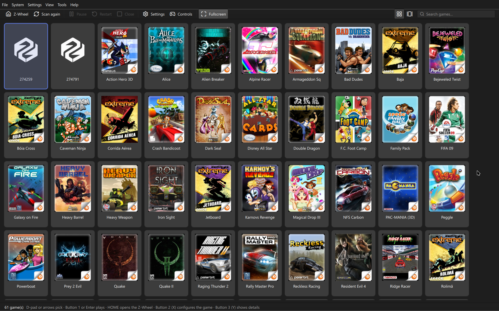

# Zeebx

An emulator for the Zeebo, the console TecToy launched in 2009 in Brazil and Mexico.

The Zeebo was digital-only: games came from TecToy's store, which has since gone offline. Roughly
60 titles remain, and they only run on people who still own the device or through console modding.
This project exists to help preserve these gems that were part of our history.

Work in progress. Today 56 of the 62 test titles get past loading and render.



## Useful links

[Discord server: https://discord.gg/D96HjsKTPa](https://discord.gg/D96HjsKTPa)

[GitHub: https://github.com/ZeebxTeam](https://github.com/ZeebxTeam)

## Installation

Ready-made builds are on the [releases](https://github.com/ZeebxTeam/zeebx-emu/releases) page: the
Windows installer, the macOS `.dmg`, the Linux `.deb` and AppImage, the Android APK and the Libretro
core. On **macOS** and **Linux** you can also install through [Homebrew](https://brew.sh):

```bash
brew install --cask zeebxteam/tap/zeebx-qt
```

Which file is which, automatic updates and the first-launch warning on macOS are covered in
[docs/en/INSTALLATION.md](docs/en/INSTALLATION.md).

## How it works

Emulating the Zeebo is not emulating a console: it is reimplementing Qualcomm BREW 4.0.2. The game
is an ARM binary that never touches hardware — it calls system interfaces through pointer tables.
So the path is to run the ARM code on an emulated core and serve each API call on the host.

The vtables we hand to the game point to addresses that **do not exist** in the memory map. When the
game calls a method, the core aborts the instruction fetch, and the address tells us which interface
and which method were requested. There are no stubs and no glue code.

The full design is in [ARCHITECTURE.md](ARCHITECTURE.md).

## Compatibility

Most ROMs run without problems; some games may freeze before initialization or during execution.

Games that use the Boomerang can be played with a Wii Remote and its motion sensors!

3D games support experimental resolution features, reaching up to 4K at 16:9.

The state of each title, with the addresses of each stop, is in
[COMPATIBILITY.md](docs/en/COMPATIBILITY.md).

For frontends such as Android and Libretro, this compatibility list may not apply. We ask that you
report any problems on those versions as well.

## Usage

With no arguments, it opens the interface. From the command line:

```bash
cargo run --release -- run "roms/Quake.zip" --window
```

Keyboard controls, command-line options and the debugging report are in
[docs/en/USAGE.md](docs/en/USAGE.md). To integrate the emulator into your own frontend, there is a
binary with no interface: see [docs/en/HEADLESS.md](docs/en/HEADLESS.md).

## Building

Rust 1.88 or newer.

```bash
cargo build --release
```

Per-platform dependencies and the builds for the interface, the command line, Libretro, Vita,
Android and iOS are in [docs/en/BUILDING.md](docs/en/BUILDING.md). How installers and releases are
assembled is in [docs/en/INSTALLERS.md](docs/en/INSTALLERS.md).

## Platforms

Linux, Windows and macOS. Mobile is in the plans, but the focus right now is the desktop!

The Libretro core and the muOS card have their own page:
[docs/en/LIBRETRO-CORE.md](docs/en/LIBRETRO-CORE.md).

## Games

The repository does not distribute games. Put yours in `roms/`, which is ignored by git, or in any
other folder, and set it in the program's settings.

## Documentation

- [Research](docs/en/RESEARCH.md) — the console, BREW platform, file formats and emulation landscape
- [Implementation guide (Portuguese)](docs/implementacao/README.md) — subsystems, decisions and their rationale

- [ARCHITECTURE.md](ARCHITECTURE.md) — how the emulator is built
- [docs/en/INSTALLATION.md](docs/en/INSTALLATION.md) — installing, updating and which release file to download
- [docs/en/USAGE.md](docs/en/USAGE.md) — command line, controls and the debugging report
- [docs/en/HEADLESS.md](docs/en/HEADLESS.md) — the interface-less binary for your own frontends
- [docs/en/LIBRETRO-CORE.md](docs/en/LIBRETRO-CORE.md) — the Libretro core and muOS
- [docs/en/BUILDING.md](docs/en/BUILDING.md) — dependencies and per-platform builds
- [docs/en/INSTALLERS.md](docs/en/INSTALLERS.md) — installers and releases
- [docs/](docs/README.md) — the research: the console, the BREW platform, the file formats and the
  state of the art of Zeebo emulation
- [docs/implementacao/](docs/implementacao/README.md) — each subsystem, with the decisions and the
  reasoning behind each one
- [TODO.md](TODO.md) — the logbook: what is done, what is missing and what has already cost dearly

## License

Zeebx's code is **GPL-2.0-or-later**: the GPLv2 text is in [LICENSE](LICENSE).

**The binaries shipped in the release are distributed under the GPLv3**, with the text in
[LICENSE-GPL3](LICENSE-GPL3). This is not a license change: all of them link libraries that are
Apache-2.0 only (`ab_glyph`, `sevenz-rust2`, `zopfli`, `cpal`, `winit`…), and Apache-2.0 is
compatible with GPLv3 but not with GPLv2. The "or later" is what allows this combination. The Qt
frontend would be GPLv3 anyway, because of Qt (see
[21-migracao-para-qt.md](docs/implementacao/21-migracao-para-qt.md)).

Anyone who wants Zeebx under GPLv2 can compile the code, but not with those dependencies.


## Who makes Zeebx

Everyone who has contributed code to Zeebx. The full list is on GitHub's
[contributors tab](https://github.com/ZeebxTeam/zeebx-emu/graphs/contributors).

<!-- contribuidores -->
<table>
  <tr>
    <td align="center" valign="top" width="16.67%"><a href="https://github.com/rebquaker"><br /><sub><b>rebquaker</b></sub></a></td>
    <td align="center" valign="top" width="16.67%"><a href="https://github.com/requeijaum"><br /><sub><b>requeijaum</b></sub></a></td>
    <td align="center" valign="top" width="16.67%"><a href="https://github.com/Meowni2"><br /><sub><b>Meowni2</b></sub></a></td>
    <td align="center" valign="top" width="16.67%"><a href="https://github.com/humbertodias"><br /><sub><b>humbertodias</b></sub></a></td>
    <td align="center" valign="top" width="16.67%"><a href="https://github.com/J0aoSiqueira"><br /><sub><b>J0aoSiqueira</b></sub></a></td>
    <td align="center" valign="top" width="16.67%"><a href="https://github.com/maskofsin"><br /><sub><b>maskofsin</b></sub></a></td>
  </tr>
</table>
<!-- /contribuidores -->

## Acknowledgments

- **tripleoxygen** — reverse engineering of the Zeebo's hardware and firmware, and the public
  material that makes this project possible :)
- **[Requeijaum](https://github.com/requeijaum)** — great support in understanding much of BREW
  and in resolving bugs
- The **Zeebo Clube** (Facebook) and **Zeebo Eterno** (Telegram) groups, for the comparisons with
  the real console that bring fidelity to the project, and the whole Zeebo community that has been
  supporting, testing and giving feedback since the beginning <3
