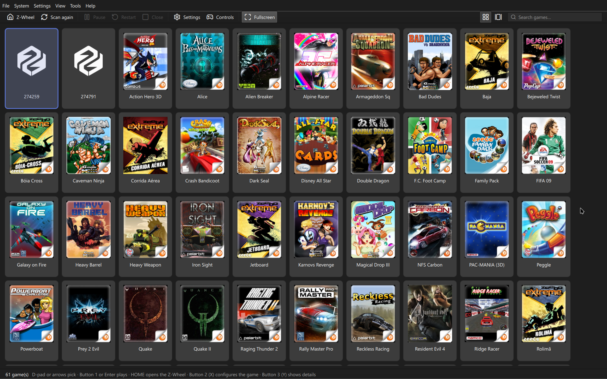

# Zeebx 

🇧🇷 [Leia em português](README.pt-BR.md)

An emulator for the Zeebo, the console TecToy launched in 2009 in Brazil and Mexico.

The Zeebo was digital-only: the games came from TecToy's store, which went offline. About 60
titles are left, and they can only be played on surviving consoles or through console modding.
This project exists to help preserve these gems that were part of our history.

In development. Today, 56 of the 62 titles get past loading and draw.



## Useful links

[Discord server: https://discord.gg/D96HjsKTPa](https://discord.gg/D96HjsKTPa)

[GitHub: https://github.com/ZeebxTeam](https://github.com/ZeebxTeam)

## Installation

The ready-made builds are in the [releases](https://github.com/ZeebxTeam/zeebx-emu/releases).

On **macOS** and **Linux**, you can also install it through [Homebrew](https://brew.sh), using the
[project tap](https://github.com/ZeebxTeam/homebrew-tap).

## Contributing

See [CONTRIBUTING.en.md](CONTRIBUTING.en.md) for contribution and frontend guidelines.

## How it works

Emulating the Zeebo is not emulating a console: it is reimplementing Qualcomm BREW 4.0.2. The game
is an ARM binary that never touches hardware — it calls system interfaces through pointer tables.
So the way to go is to run the ARM code on an emulated core and serve each API call on the host.

The vtables we hand the game point to addresses that **do not exist** in the memory map. When the
game calls a method, the core aborts the instruction fetch and the address tells us which
interface and which method were requested. There is no stub, and no glue code.

The full design is in [ARCHITECTURE.md](ARCHITECTURE.md).

## Compatibility

Compatibility varies by game and frontend. See the [compatibility list](COMPATIBILITY.md) for the
status of each title and known issues; please report problems, especially when using Android or
Libretro.

## Building

The command below builds the workspace. Platform-specific requirements are documented in the
corresponding frontend readmes.

```bash
cargo build --release
```

## Games

The repository does not distribute games. Put yours in `roms/`, which git ignores, or in any other folder, and set it in the program's settings.

## Documentation

- [ARCHITECTURE.md](ARCHITECTURE.md) — how the emulator is built
- [Headless frontend](frontends/headless/README.md), [Android](frontends/android/README.md), [iOS](frontends/ios/README.md), and [Vita standalone](frontends/vita-standalone/README.md)
- [Libretro plan](docs/libretro/LIBRETRO_PLAN.md)
- [Research](docs/README.md) — the console, BREW, file formats and emulator landscape
- [Implementation](docs/implementation/README.md) — subsystems, design decisions and rationale
- [TODO.md](TODO.md) — the logbook: what is done, what is missing and what has already cost dearly
- [CONTRIBUTING.en.md](CONTRIBUTING.en.md) — pull requests, the `development` branch, and new frontends

## License

Zeebx's code is **GPL-2.0-or-later**: the GPLv2 text is in [LICENSE](LICENSE).

**The binaries that ship in the release are distributed under GPLv3**, with the text in
[LICENSE-GPL3](LICENSE-GPL3). This is not a license change: all of them link libraries that are
Apache-2.0 only (`ab_glyph`, `sevenz-rust2`, `zopfli`, `cpal`, `winit`…), and Apache-2.0 is
compatible with GPLv3 but not with GPLv2. The "or later" is what allows this combination. The Qt
frontend would be GPLv3 anyway, because of Qt (see
[21-qt-migration.md](docs/implementation/21-qt-migration.md)).

Whoever wants Zeebx under GPLv2 can build the code, but not with those dependencies.


## Who makes Zeebx

Everyone who has ever contributed code to Zeebx. The full list is in GitHub's
[contributors tab](https://github.com/ZeebxTeam/zeebx-emu/graphs/contributors).

<!-- contributors -->
<table>
  <tr>
    <td align="center" valign="top" width="16.67%"><a href="https://github.com/rebquaker"><br /><sub><b>rebquaker</b></sub></a></td>
    <td align="center" valign="top" width="16.67%"><a href="https://github.com/requeijaum"><br /><sub><b>requeijaum</b></sub></a></td>
    <td align="center" valign="top" width="16.67%"><a href="https://github.com/Meowni2"><br /><sub><b>Meowni2</b></sub></a></td>
    <td align="center" valign="top" width="16.67%"><a href="https://github.com/humbertodias"><br /><sub><b>humbertodias</b></sub></a></td>
    <td align="center" valign="top" width="16.67%"><a href="https://github.com/J0aoSiqueira"><br /><sub><b>J0aoSiqueira</b></sub></a></td>
    <td align="center" valign="top" width="16.67%"><a href="https://github.com/maskofsin"><br /><sub><b>maskofsin</b></sub></a></td>
  </tr>
  <tr>
    <td align="center" valign="top" width="16.67%"><a href="https://github.com/lucmsilva651"><br /><sub><b>lucmsilva651</b></sub></a></td>
  </tr>
</table>
<!-- /contributors -->

## Thanks

- **tripleoxygen** — reverse engineering of the Zeebo's hardware and firmware, and the public
  material that makes this project possible :)
- **[Requeijaum](https://github.com/requeijaum)** — great support in understanding a good part of
  BREW and in fixing bugs
- The **Zeebo Clube** (Facebook) and **Zeebo Eterno** (Telegram) groups, for the comparisons with
  the real console that bring fidelity to the project, and the whole Zeebo community that has been
  supporting, testing and giving feedback since the beginning <3
