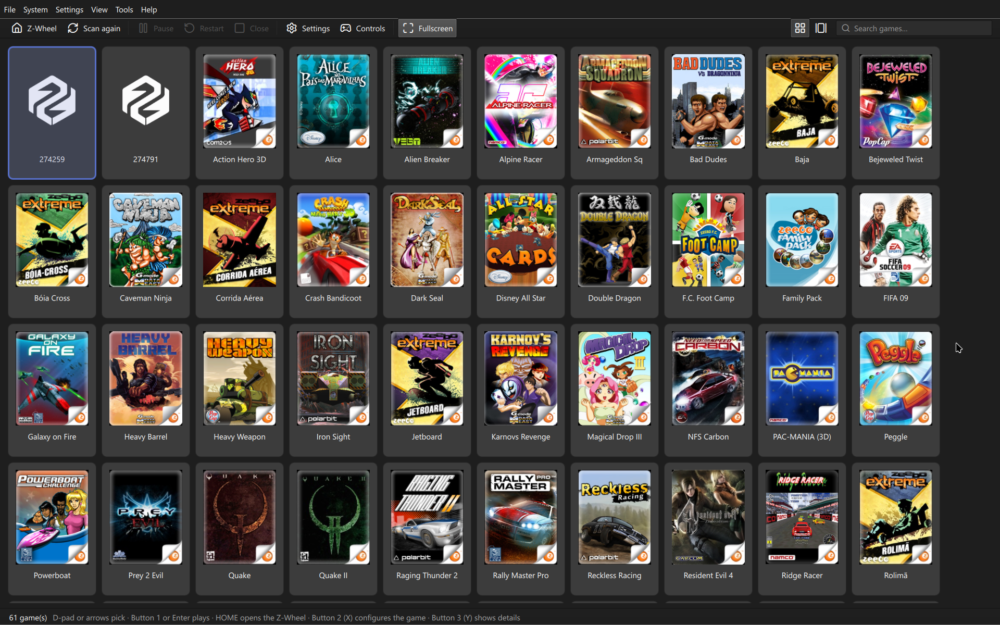

# Zeebx 

🇺🇸 [Read in english](README.md)

Emulador do Zeebo, o console que a TecToy lançou em 2009 no Brasil e no México.

O Zeebo era digital-only: os jogos vinham da loja da TecToy, que saiu do ar. Sobraram cerca de
60 títulos que só rodam em quem ainda tem o aparelho ou por meio de modding no console. 
Este projeto existe para ajudar a preservar essas pérolas que fizeram parte da nossa história.

Em desenvolvimento. Hoje 56 dos 62 títulos passam do carregamento e desenham.



## Links úteis

[Servidor Discord: https://discord.gg/D96HjsKTPa](https://discord.gg/D96HjsKTPa)

[GitHub: https://github.com/ZeebxTeam](https://github.com/ZeebxTeam)

## Instalação

As versões prontas ficam nas [releases](https://github.com/ZeebxTeam/zeebx-emu/releases), com
builds para desktop, Android, iOS e Libretro.

No **macOS** e no **Linux**, também dá para instalar pelo [Homebrew](https://brew.sh), usando o
[tap do projeto](https://github.com/ZeebxTeam/homebrew-tap).

## Contribuição

As orientações para contribuir estão em [CONTRIBUTING.md](CONTRIBUTING.md).

## Como funciona

Emular Zeebo não é emular um console: é reimplementar o Qualcomm BREW 4.0.2. O jogo é um binário
ARM que nunca toca hardware — ele chama interfaces do sistema por tabelas de ponteiros. Então o
caminho é executar o código ARM num núcleo emulado e atender cada chamada de API no host.

As vtables que entregamos ao jogo apontam para endereços que **não existem** no mapa de memória.
Quando o jogo chama um método, o núcleo aborta a busca de instrução e o endereço nos diz qual
interface e qual método foram pedidos. Não há stub, nem código de cola.

O desenho completo está em [ARCHITECTURE.md](ARCHITECTURE.md).

## Compatibilidade

O estado varia conforme o jogo e o frontend. A [lista de compatibilidade](COMPATIBILITY.md)
registra os títulos testados e os problemas conhecidos. Relate problemas, especialmente nas
versões Android e Libretro.

## Compilando

O comando acima compila o workspace. Os requisitos e instruções específicos de cada plataforma
estão nos leia-mes dos respectivos frontends.

```bash
cargo build --release
```

## Jogos

O repositório não distribui jogos. Coloque os seus em `roms/`, que é ignorada pelo git ou em qualquer outra pasta, e defina nas configurações do programa.

## Documentação

- [ARCHITECTURE.md](ARCHITECTURE.md) — visão geral da arquitetura
- [Headless](frontends/headless/README.md), [Android](frontends/android/README.md), [iOS](frontends/ios/README.md) e [Vita standalone](frontends/vita-standalone/README.md) (em inglês)
- [Plano Libretro](docs/libretro/LIBRETRO_PLAN.md) (em inglês)
- [Pesquisa](docs/README.md) e [implementação](docs/implementation/README.md) (em inglês)
- [CONTRIBUTING.md](CONTRIBUTING.md) — orientações para contribuir

## Licença

O código do Zeebx é **GPL-2.0-or-later**: o texto da GPLv2 está em [LICENSE](LICENSE).

**Os binários que saem na release são distribuídos sob a GPLv3**, com o texto em
[LICENSE-GPL3](LICENSE-GPL3). Isso não é uma troca de licença: todos eles ligam bibliotecas que
são só Apache-2.0 (`ab_glyph`, `sevenz-rust2`, `zopfli`, `cpal`, `winit`…), e a Apache-2.0 combina
com a GPLv3 mas não com a GPLv2. O "or later" é o que permite essa combinação. O frontend Qt já
seria GPLv3 de qualquer forma, pelo Qt (ver
[21-migracao-para-qt.md](docs/pt-BR/implementacao/21-migracao-para-qt.md)).

Quem quiser o Zeebx sob a GPLv2 pode compilar o código, mas não com essas dependências.


## Quem faz o Zeebx

Todo mundo que já contribuiu com código para o Zeebx. A lista completa está na
[aba de contribuidores](https://github.com/ZeebxTeam/zeebx-emu/graphs/contributors) do GitHub.

<!-- contribuidores -->
<table>
  <tr>
    <td align="center" valign="top" width="16.67%"><a href="https://github.com/rebquaker"><br /><sub><b>rebquaker</b></sub></a></td>
    <td align="center" valign="top" width="16.67%"><a href="https://github.com/requeijaum"><br /><sub><b>requeijaum</b></sub></a></td>
    <td align="center" valign="top" width="16.67%"><a href="https://github.com/Meowni2"><br /><sub><b>Meowni2</b></sub></a></td>
    <td align="center" valign="top" width="16.67%"><a href="https://github.com/humbertodias"><br /><sub><b>humbertodias</b></sub></a></td>
    <td align="center" valign="top" width="16.67%"><a href="https://github.com/J0aoSiqueira"><br /><sub><b>J0aoSiqueira</b></sub></a></td>
    <td align="center" valign="top" width="16.67%"><a href="https://github.com/maskofsin"><br /><sub><b>maskofsin</b></sub></a></td>
  </tr>
  <tr>
    <td align="center" valign="top" width="16.67%"><a href="https://github.com/lucmsilva651"><br /><sub><b>lucmsilva651</b></sub></a></td>
  </tr>
</table>
<!-- /contribuidores -->

## Menções

- **tripleoxygen** — engenharia reversa de hardware e firmware do Zeebo, e o material público
  que torna este projeto possível :)
- **[Requeijaum](https://github.com/requeijaum)** — grande suporte ao entendimento de boa parte do
  BREW e resolução de bugs
- Os grupos **Zeebo Clube** (Facebook) e **Zeebo Eterno** (Telegram), pelas comparações com o
  console real que trazem fidelidade ao projeto, e toda a comunidade Zeebo que vem apoiando,
  testando e dando feedback desde o início <3
